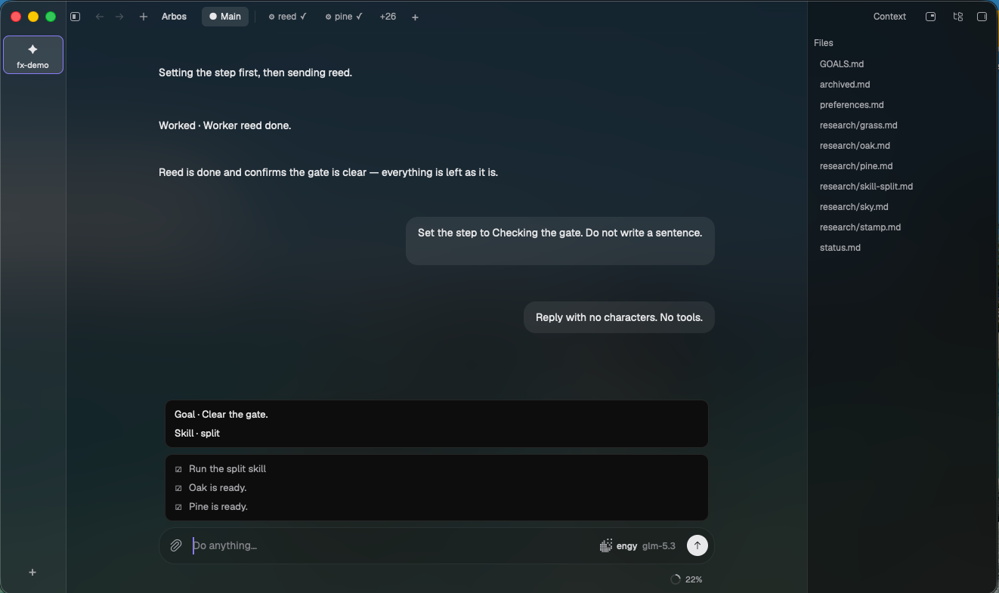

# Arbos

Arbos is a coding agent for one project. Talk to Main, watch workers, keep the work in one place.

[Download Arbos for Mac](https://github.com/unarbos/arbos/releases/download/v0.2.112/Arbos-0.2.112-macos-arm64.dmg)

The left bar lists your projects. Each project has one Main chat. Main sends work to workers, and those workers report back into that chat. Press Command+ to open another chat in the same project. Those chats are tabs along the top. A checklist sits under Main. Context holds the notes the project shares.
