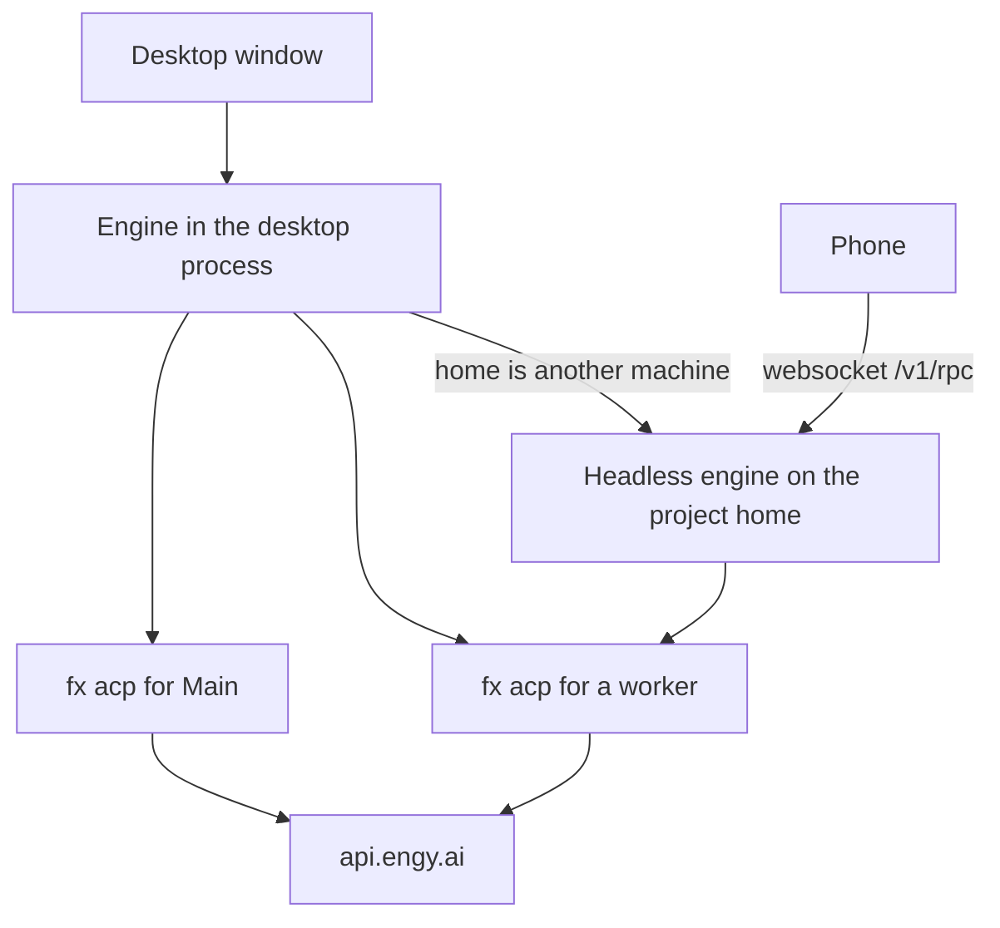

# Architecture

The desktop, fx, the headless engine, and the phone are four pieces of one app. The engine is the center. fx is the harness it starts. The phone is a client of the engine.

## Desktop

The window is the `zeron` binary. `arbos` starts the same program. The window title is Arbos. `zeron --version` prints `Arbos 0.2.111`.

On startup the window looks for an engine already listening on the local port. If it finds one, it attaches over `ws://127.0.0.1:<port>`. If it does not, it runs the engine inside the same process and serves that port itself.

The window opens a folder as a project. The project lives in `<folder>/.arbos/`.

## fx

The engine starts one `fx acp` process for Main, and one more for each worker. fx speaks `https://api.engy.ai/v1`. The model is `glm-5.3`. The key arrives as `ENGY_API_KEY`.

A chat's fx files are `<folder>/.arbos/agents/<id>/fx`. When a chat has no home of its own, the process uses `ARBOS_FX_HOME` if that variable is set, and otherwise `~/.local/share/arbos/fx`.

## Headless engine

`arbos headless` is the engine with no window. `zeron headless` is the same command. The home machine of a project runs it. It listens on `127.0.0.1` only. A tunnel publishes that port. Cloudflare Access stands in front.

Timers and other wakes keep running after the desktop window quits. A worker can run on this machine, or on another registered install. The MacBook worker is offline. This build has no hosted sign-in and no hosted sync.

## Phone

The phone is the SwiftUI app in `ios/`. Its bundle id is `com.unarbos.arbos.ios`. It opens a websocket to `GET /v1/rpc` on the home engine. It lists projects, follows Main, and sends a prompt. It does not start fx. It has no voice and no calls.

TestFlight accepted build 7. The phone is not installed on a device. The MacBook is offline, so signing stops there.

## Processes

When the project home is this computer, the desktop's engine is the home engine. The headless process is the same engine running on another machine.
